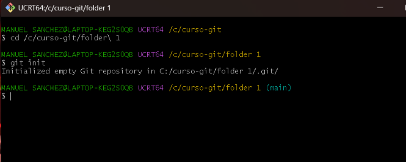
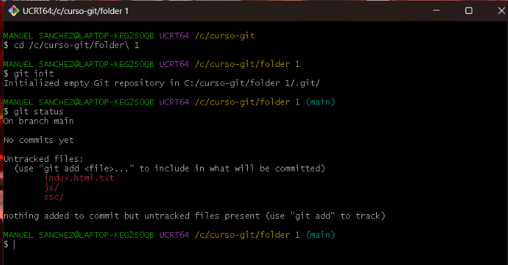
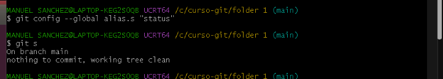

# CURSO-GIT

##1.- ¿Que aprendi del video?

Aprendi que git es un sistema que guarda el historial de cambios de una carpeta que contiene informacion o de un proyecto y que git hub es la plataforma donde web donde se almacenan los repositorios en los cuales se pueden descargar en otros equipos para que se pueda trabajar en equipo en un mismo repositorio .

## 2. Comandos usados

**git init: **Crea el repositorio en la carpeta
**git status:** Muestra el estado de los archivos 
**git add . **: Agrega todos los cambios
**git commit -m "mensaje":** Guarda los cambios en el historial
**git log / git log --oneline:** Muestra los commits
**git config --global alias.s "status":** Crea el atajo git s
**git mv:** Renombra un archivo
**git tag :** sirve para poner una etiqueta con nombre a un commit
**git checkout:**cambia de una rama a otra
**git merge:** une los cambios de una rama dentro de otra
**git branch:**crea o borra ramas
**git reflog: ** muestra el historial de todo lo que hizo el HEAD

### Paso a paso
1. Creé la carpeta folder 1 y la inicié con git init.
 
2. Creé archivos (indux.html, js/compresion.js, principal.html)
   y revisé con git status. 
 
3. Los agregué con git add y guardé con git commit.
![image alt]
4. Consulté el historial con git log. 
![image alt]
5. Creé el alias git s para git status.

6. Renombré principal.html a princ.html con git mv. 
![image alt]

## 3. Dificultades y cómo las resolví
- Al principio no sabia como abrir el archivo hasta que entendi que tenia que hacer la carpeta para crear el repositorio
- *Archivos con .txt:*  Windows ocultaba la extensión y
  los archivos quedaron como principal.html.txt. entonces cuando ponia solo nombre del archivo me dia que no existia el archivo 
- *Error "bad source" en git mv:* escribí mal el nombre
  del archivo entonces active la extension del nombre archivo del explorador para que no se me olvidara
- Al hacer los documentos en el bloc de notas no sabia que a la hora de guardar, el archivo tiene que ser para todos los tipos de archivos
